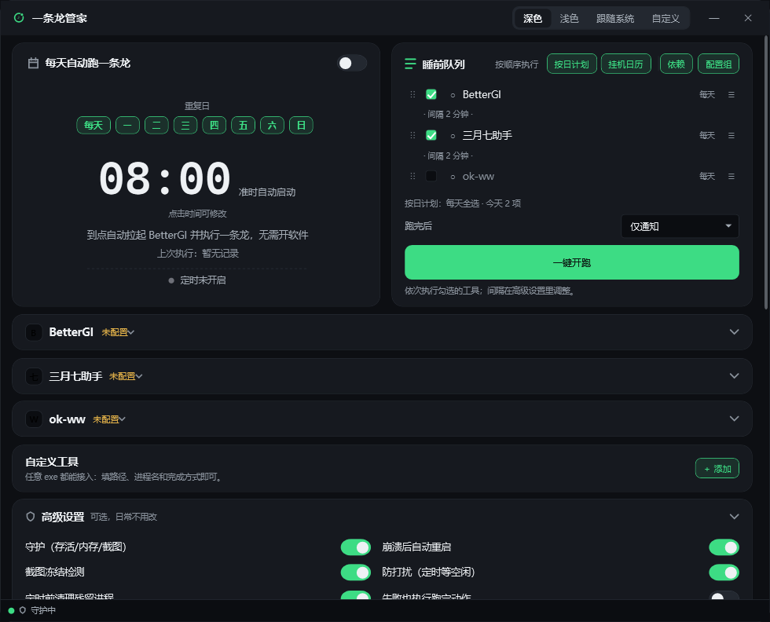
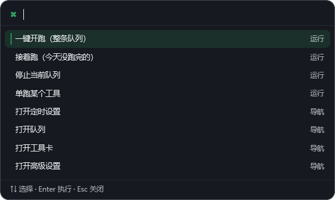
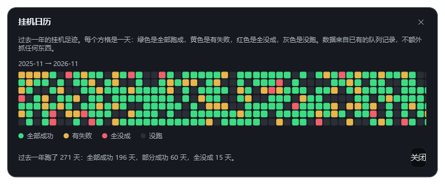

# Dragon Butler · 一条龙管家

<p align="center">
  
</p>

<p align="center">
  <strong>One desktop butler for all your game dailies</strong><br>
  <sub>Queue multiple tools · keep the machine awake · schedule · notify when done</sub>
</p>

<p align="center">
  <a href="README.md">简体中文</a> · <a href="README.en.md"><strong>English</strong></a>
</p>

<p align="center">
  
  
  <a href="https://github.com/laopiaoke/Dragon-Butler/actions/workflows/build.yml"></a>
  <a href="https://github.com/laopiaoke/Dragon-Butler/releases/latest"></a>
  
  <a href="https://github.com/laopiaoke/Dragon-Butler/stargazers"></a>
  <a href="https://github.com/laopiaoke/Dragon-Butler/issues"></a>
  <a href="https://github.com/laopiaoke/Dragon-Butler/commits/main"></a>
</p>

> [!IMPORTANT]
> **Disclaimer**
>
> This project is **AI-assisted**. The code, documentation and release pipeline were generated or rewritten with AI help.
> The author **does not have a programming background** and cannot professionally guarantee code quality, security or stability,
> nor rule out mistakes or omissions in AI-generated content.
> Please assess the risk yourself and back up important data before use. Issues are welcome, but please understand that
> troubleshooting capacity is limited.

---

## Version information

| Item | Value |
|---|---|
| Current version | **v1.13** |
| In-app version | `1.13.0` |
| Released | 2026-11-13 |
| Supported OS | Windows 10 / 11 (x64) |
| Prerequisite | You supply the tools it drives, e.g. [BetterGI](https://github.com/babalae/better-genshin-impact). This app contains **no** game automation of its own |
| Dependencies | Zero third-party libraries, zero runtime install (the portable build bundles .NET 8) |
| License | MIT |

## What it is

**Dragon Butler is a Windows desktop "butler" for game automation tools.** It does not run your dailies itself. Instead it takes the tools you already use — [BetterGI](https://github.com/babalae/better-genshin-impact), March7thAssistant, ok-ww, or any exe you point it at — lines them up in a queue, launches them one by one, waits until each one *actually* finishes, and then wraps up.

Tick the tools you want tonight, press **Start the queue** once: launch the first → wait for a real completion signal → wait a few minutes → launch the next → send one summary when everything is done. Optionally put the PC to sleep or shut it down afterwards.

It **does not replace those tools, and does not modify any game or tool file.** It only does four things: start processes, read public logs, listen to a local webhook, and manage process lifetimes.

## What it does

- **Bedtime queue** — tick BetterGI / March7thAssistant / ok-ww, press start, they run in order, you get one summary.
- **Per-day plans** — a different tool set for each weekday; weekly bosses and dailies can be separated automatically.
- **After-run action** — notify only / sleep / shut down (with a 60-second cancellable countdown).
- **Schedule + do-not-disturb** — start at a set time; if you're still using the PC it waits for idle, then runs.
- **Auto-discovery of tool paths** — one click usually finds them.
- **Keep-awake** — while the queue runs it blocks idle sleep, update reboots and the screensaver; restores everything afterwards.
- **Custom tools** — any exe works, with three completion modes and auto-extracted icons.
- **Morning report** (off by default) — one sentence about yesterday the first time you open it each day.

| Capability | Details |
| --- | --- |
| **After it finishes** | Notify only (default) / sleep / shut down (60 s countdown, cancellable). Destructive actions are skipped if anything failed. |
| **When something fails** | Retry once; if it still fails, either skip and continue or abort the queue, per your setting. |
| **While it runs** | The guardian only reports real trouble: process vanished, memory high, screen frozen. It prefers missing a report over killing something. |
| **Telling you** | One summary message (how many succeeded, who failed, total time) via Windows toast or your phone (WeCom / Feishu / DingTalk / Telegram / Bark / email / webhook, etc.). |
| **Schedule + do-not-disturb** | Starts on time; waits for idle if you're at the PC; "vacation mode" disables all schedules at once. |
| **Per-day plans** | Per-tool weekday masks; they only constrain scheduled runs — a manual start always runs the current ticks. |
| **Built-in tools** | BetterGI (one-dragon / config groups), March7thAssistant, ok-ww; paths auto-discovered. |
| **Custom tools** | Any exe: path, process name, completion mode; icon extracted automatically, replaceable. |
| **Custom signals** | Completion can be any combination of: log contains text / file appears / main window title contains. |
| **Keep-awake** | Blocks idle sleep, update reboots and the screensaver during a run; restores on completion. |
| **Night screen-off** | Turns the monitor off after N minutes (off by default); the system stays awake and the queue keeps running. |
| **Suspected hang** | Process alive but no CPU or log activity for 3 minutes → pause and notify; optional auto-kill. |
| **Appearance** | Dark / light / follow system, or a palette colour or your own image as background. |
| **Global hotkeys** | Off by default. `Ctrl+Alt+R` start, `Ctrl+Alt+S` stop, works when the game is fullscreen; remappable. |
| **Progress at a glance** | Taskbar progress bar + tray tooltip; optional 180×44 mini bar that shows only progress. |
| **Snapshot now** | One tray item grabs the current screen into `全部日志\snapshots\` and pushes the path into a notification. |
| **Uptime calendar** | A one-year grid, one cell per day: green all passed / yellow some failed / red all failed / grey not run. Built from existing records. |
| **Command palette** | `Ctrl+K` — search commands, jump to settings, or run a single tool directly. |
| **Dependency ordering** | A matrix deciding "who must finish before whom": dependencies move up automatically, and a failed prerequisite either skips or stops the queue. Cyclic ticks are rejected on save. |
| **Config-group slicing** | Let one queue item run only specific BetterGI config groups; unset means "use the global ticks", so one queue can cover a daytime and an evening set. |
| **Version pre-check** | Remembers the BetterGI version of the last *successful* run and warns when it changed. Reads the local file version only — no network. |
| **Harvest ledger** | Off by default. Tallies mora / dog-food EXP / picked materials from the BGI log, reports once at the end of a queue, accumulates monthly. |
| **MCP interface** | Lets MCP-capable AI assistants query status, start, stop, or run one tool. Shares the token and port with the control API; off by default. |
| **Where it is now** | A live strip on top of the queue card: current config group, elapsed, time left, and queue position. Estimates come from the last 14 days' median; with too few samples it stays silent. |
| **Today** | Per-group start/end, how long each took, faster or slower than usual, and which tool failed. Copyable as plain text. |

## Recent updates (v1.13)

- **You can finally see where it is.** Once the queue starts, a live strip appears on top of the queue card: `● 日常 · 18 min　2 min left · ends ~23:06　5/7` — which config group is running, how long it has been going, roughly when it wraps up, and how far the whole queue has got. When idle the strip collapses entirely.
- **Estimates come from your own history.** Each group uses its median over the past 14 days (reopened segments and unfinished runs are excluded). With fewer than two samples it shows no estimate at all — better to say nothing than to show a number that is obviously wrong. Past the median it switches to "running long" rather than displaying a finish time that has already passed.
- **The mini bar no longer just shows "3/5".** That number barely moves while you are away, so it carried almost no information. Now the first line is "group · elapsed" and the second is "time left"; if the full sentence does not fit in 180×44 it falls back to a short form (over an hour switches to a clock time).
- **New "Today" window** (queue card header, or `Ctrl+K` → "today"): when each config group ran, how long it took, faster or slower than usual, plus the queue ledger (which tool failed and with what exit code). One click copies it as plain text.
- **The current config group used to be a dead field.** The sentinel always had a `CurrentGroup` field, but no code ever wrote to it — so the app itself did not know which group was running. This release wires it up: both the webhook and the log source can write it, and a late "ended" event from the previous group no longer wipes out the new one.

<details>
<summary>v1.12 Visible fixes only</summary>

- **Visible fixes only, no new features.** Six issues found by actually looking at the UI, fixed one by one: the command palette now marks the selected row with a left bar plus a tinted background; the mini bar's two lines no longer blur together; the dependency matrix headers are brighter and set at 12.5px; the calendar's month label moved above the grid instead of taking a column and pushing the grid into the middle; the queue card now separates "view" buttons from "orchestration" buttons with a thin divider.
- **Bilingual README** — this English file is new; both are linked at the top of each, and the Chinese side gained a version-information table (current version / in-app version / supported OS / prerequisites).
- **New screenshots** — the UI section now uses real v1.12 captures, plus two new ones for the command palette and the calendar.

</details>

<details>
<summary>v1.11 MCP interface</summary>

- **MCP interface** — use it as an MCP server for AI assistants (Claude Desktop / Cursor / Cherry Studio and friends). Four tools: status, start, stop, run one tool. **No npm or Python dependency** — a small hand-written JSON-RPC 2.0 layer rides the existing `HttpListener`, sharing the token and port with the control API, opening no extra port. Off by default; while off everything returns 404.

</details>

<details>
<summary>v1.10 How much did this run earn</summary>

- **Harvest ledger** (off by default, enable under Advanced) — tallies mora, dog-food EXP and picked materials from the BGI log, and appends "about 125k mora, Sweet Flower ×12 this run. 3.4M mora this month." to the end-of-queue notification. Parsing is **deliberately conservative**: only shapes like `摩拉 +125000` with an explicit separator are accepted. Better to under-count than to guess.
- **Missed-schedule note in the morning report** — if yesterday's scheduled run never happened, the morning report says "yesterday's 08:00 schedule did not run (missed the 120-minute catch-up window)". Previously this was silent: you only saw "last run: two days ago".

</details>

<details>
<summary>v1.9 The queue learns to argue</summary>

- **Dependency ordering** — a "Dependencies" button in the queue card opens a matrix of "who must finish before whom". With it set, the queue runs in dependency order: prerequisites move up, ties keep your drag order; a failed prerequisite can either let the rest skip (default) or stop the whole queue. Cyclic ticks are rejected on save with the offending items named.
- **Config-group slicing** — a "Groups" button lets an item run only specific BetterGI config groups. Daytime dailies and evening events can share one queue with no manual switching; leaving it empty means "use the global ticks".
- **BetterGI version pre-check** — remembers the BetterGI version of the last **successful** run and warns when it changed before a new run. Reads the local file version only; no network, no download, no auto-update; silent when the version can't be read.

</details>

<details>
<summary>v1.8 Handy and glanceable</summary>

- **Global hotkeys** (off by default) — `Ctrl+Alt+R` start, `Ctrl+Alt+S` stop, works in fullscreen games; remappable.
- **Glanceable progress** — taskbar progress bar while running, tray tooltip showing "item 2 of 5"; plus an optional 180×44 mini bar that only shows progress, draggable and position-remembering.
- **Snapshot now** — a tray item that grabs the current screen into `全部日志\snapshots\` and pushes the path into a notification.
- **Uptime calendar** — a one-year grid, one cell per day: green all passed, yellow some failed, red all failed, grey not run. All from existing records.
- **Speak when done** (off by default) and the **command palette** (`Ctrl+K` to search commands, settings and tools).

</details>

<details>
<summary>v1.7 Remote view and weekly report</summary>

- **Local control API** — scripts and AI assistants can drive it: `/api/status`, `/api/start`, `/api/stop`, `/api/run?tool=bettergi`, with a 32-character token header. Off by default; while off it doesn't even reveal that the endpoint exists.
- **Phone progress page** — on the same Wi-Fi, open an address in a phone browser to see progress and the latest event. The page has no buttons: read-only.
- **Weekly report** — the first time you open it each week, a summary of the last seven days: which days ran, success rate, total time, busiest day.

</details>

<details>
<summary>v1.6 Reliability loop</summary>

- **Catch-up window** — missing the exact minute no longer means "not today". A configurable catch-up window (default 120 minutes) lets a late boot still run, and the log says `补跑 (scheduled 08:00, actual 09:12)`.
- **Resume** — if a queue was interrupted, the queue card and tray offer "Resume (N items left today)"; only the unfinished ones run.
- **Failure bundle** — at the moment of failure it packages the log tail, redacted settings, process list and a screenshot into `全部日志\incidents\`, and the notification carries the path.
- **Notifications that explain themselves** — no more "see the log". They now include the exit code, the last error log line, and the concrete stall/hang criterion.
- **Configurable retry backoff** — count, first delay and doubling are all configurable, capped at 300 seconds.

</details>

## The interface

> Three layers: queue card (hero) → tool cards (collapsed) → advanced settings (collapsed); the guardian lives in the shield at the bottom.

<p align="center">
  
  <br>
  <sub>Figure 1 · v1.13 main window (dark, queue running): the live strip on top of the queue card shows the current config group, elapsed time, estimated finish and queue position</sub>
</p>

One screen, three blocks, read top to bottom:

- **Top · schedule card + bedtime queue** — on the left, time and repeat days; on the right, tick tools, drag to reorder, press Start. While running the button turns red ("Stop"), and you can pick what happens afterwards; when waiting for idle a "start now (skip the wait)" button appears. The "Per-day plan" button assigns tools to weekdays and shows "every day / 6 days" next to each tool.
- **Middle · tool cards** (collapsed by default) — each card is "path + browse / auto-find / test launch / change icon". Auto-find fills the path in; you must press "use this path" for it to take effect. The BetterGI card additionally holds the one-dragon config name and config-group ticks.
- **Bottom · advanced settings** (collapsed by default) — keep-awake, night screen-off, auto-kill on suspected hang, morning report, guardian, crash restart, screen-check, do-not-disturb, residual cleanup before scheduled runs, failure strategy, tool interval, run the after-action even on failure, optional event push URL.
- **Status bar** — on the left the shield (green = guarding, grey = off, yellow = recent alert, hover for details); on the right the latest event.

### Per-day plan (v1.5)

<p align="center">
  
  <br>
  <sub>Figure 2 · v1.5 per-day plan: a 7-day × tool matrix; click a weekday to toggle the whole row, a tool name to toggle the column</sub>
</p>

Tick which days each tool runs: weekly bosses on weekends, dailies on weekdays. **This only affects scheduled runs** — a manual start always runs the current ticks. If a day has nothing ticked, that scheduled run is skipped with a "today's plan is empty" notice.

<p align="center">
  
  <br>
  <sub>Figure 3 · v1.5 tool card: path / browse / auto-find / test launch / change icon; BetterGI additionally shows the config name and groups</sub>
</p>

<p align="center">
  
  <br>
  <sub>Figure 4 · v1.12 advanced settings: keep-awake, night screen-off, suspected hang, morning report, weekly report, harvest ledger, plus the guardian and queue options</sub>
</p>

<p align="center">
  
  <br>
  <sub>Figure 4b · Command palette (Ctrl+K): search commands and settings, or run a single tool; ↑↓ to select, Enter to run, Esc to close</sub>
</p>

<p align="center">
  
  <br>
  <sub>Figure 4c · Uptime calendar: one cell per day for the past year — green all passed / yellow some failed / red all failed / grey not run</sub>
</p>

<p align="center">
  
  <br>
  <sub>Figure 4d · Today (v1.13): when each group ran, how long it took, faster or slower than usual, plus the queue ledger</sub>
</p>

<p align="center">
  
  <br>
  <sub>Figure 4e · Mini bar (v1.13, running): first line "group · elapsed", second line "time left", 2px progress line at the bottom</sub>
</p>

### Custom tools and custom signals (v1.5)

<p align="center">
  
  <br>
  <sub>Figure 5 · v1.5 custom tool: three completion modes — process exit / elapsed time / custom signal</sub>
</p>

- **Process exit (code 0)** — for tools that quit on their own when finished.
- **Elapsed time** — considered done after N minutes, then the process is ended; for tools that never exit.
- **Custom signal** — fill in at least one of three conditions; matching any one counts as done: log contains text (one per line), file appears, main window title contains.

After a custom signal fires it enters **cross-check**: the tool must also exit with code 0 to count as really done. If it doesn't exit within a 5-minute grace period the queue pauses and waits for you, so "logged done but still running" doesn't get misjudged.

A saved tool is added to the queue automatically; the card reads the exe's icon, falling back to the first letter of its name. Any tool can get a custom icon (.ico / .png / .jpg, or borrowed from another exe), and a "restore default" button appears once you set one. "Edit" changes path/arguments/completion mode, and tools can be deleted (the three built-ins cannot).

## Guardian and completion detection

The guardian lives in the bottom shield: green = guarding, grey = off, yellow = recent alert (something anomalous in the last 30 minutes) or **escorting**; hover to see heartbeat count, memory, CPU, screen-check, webhook port, escort items and restart count. It watches three things:

| Watch | What it looks at | On anomaly |
| --- | --- | --- |
| Crash restart | Whether the tool process vanished and whether a queue is running | Outside a queue, relaunch after a 60-second cooldown; during a queue, let the queue decide so nothing gets double-started |
| Memory | System usage / tool working set | Notify only, never touch the process |
| Frozen screen | Grayscale difference between timed screenshots | Notify only, keep the screenshot (**not** wired into completion) |

**How completion is decided for BGI:** the primary signal is the log anchor `一条龙和配置组任务结束` (BGI prints "task finished" several times mid-run, so a bare match would be wrong). Once it arrives, any one of these cross-checks confirms completion:

- the associated game process exits; or
- BGI's webhook emits `dragon.end` (faster, if configured); or
- BGI exits normally with code 0 — added in v1.3.1, solving the case where the game stays open and no webhook is configured.

If none of them arrives within the grace period → **halted**: the queue stops and tells you, and it never guesses its way onward.

**Suspected hang (v1.4):** the process is alive but CPU stays under 5% and the associated log stops growing for 3 consecutive minutes → state becomes `STALLED`, the queue pauses and notifies you. By default the process is left alone; with "auto-kill suspected hangs" enabled it ends the process and continues per the failure strategy (skip by default). Tools without log files are judged by CPU alone.

**Three things it deliberately won't do** (better to miss a report than to kill something): it will not restart on a frozen screen, will not restart because the game exited, and only considers a restart when "tool vanished" and "queue is running" are both true.

## Keep-awake (v1.4)

Enabled automatically when the queue actually starts, restored the moment the queue ends, stops, or halts. Silent when everything is normal: no notifications, only log lines.

| Item | What it does | How it's restored |
| --- | --- | --- |
| Block idle sleep | `SetThreadExecutionState(ES_CONTINUOUS \| ES_SYSTEM_REQUIRED)` keeps the system from sleeping when idle | Cleared back to `ES_CONTINUOUS` |
| Block update reboots | `ShutdownBlockReasonCreate` makes Windows ask before rebooting instead of rebooting silently | `ShutdownBlockReasonDestroy` |
| Block the screensaver | Records the original `ScreenSaveActive` value and disables it temporarily | Restores the original value; compensates on next launch if that fails |
| Night screen-off (optional, off by default) | Turns the monitor off after N minutes (5–120); the system stays awake and the queue keeps running | Cancels the pending screen-off when the queue ends |

While running, the shield turns yellow ("escorting") and hovering lists the active items. It **does not** block a manual shutdown or sleep, and does not force-block Windows Update — it only lowers the chance of a run being interrupted.

## Scheduling

<p align="center">
  
  <br>
  <sub>Figure 6 · v1.5 time picker: a 24-hour double dial, outer 1–12, inner 13–23 and 0</sub>
</p>

- Dial: outer ring 1–12, inner ring 13–23 and 0; click or drag; picking the hour moves on to minutes automatically.
- Keyboard: type `0830` for precise entry.
- Repeat days: every day or any weekday combination; fires at most once per day.
- "Back" returns to the overview immediately with the card height corrected in the same frame, so there's no half-second jump.

## Appearance

Four modes: dark / light / follow system / custom. The first three are presets:

<p align="center">
  
  <br>
  <sub>Figure 7 · v1.5 light theme: same layout, only the palette changes</sub>
</p>

Custom mode does two things:

<p align="center">
  
  <br>
  <sub>Figure 8 · v1.5 custom theme: live preview on the left, parameters on the right, contrast reading at the bottom</sub>
</p>

- **Palette colour picker** — 18 presets plus the system colour picker.
- **Image background** — pick a local image and set the veil strength (0–90%).

The editor previews live: change a parameter and the whole app follows immediately; the bottom shows the live body-text contrast ratio (`15.4:1 · AAA` style). "Restore default theme" returns to follow-system; "Cancel" writes nothing.

A custom background stays readable thanks to three layers: background image → translucent veil → cards, so **text always sits on a card**; card brightness is anchored per scheme (dark blends 93% toward `#16191F`, light blends 90% toward white), so even a loud background won't wash the text out.

## Hooking it up to an AI assistant (MCP)

Since v1.11 it can act as an **MCP server** for AI assistants — Claude Desktop, Cursor, Cherry Studio and similar clients can point at one URL and then "check status, start, stop, run a single tool".

First enable the **local control API** under Advanced settings (MCP shares the same 32-character token and the same listening port — it is a fourth entry point on that port, not a new port). Then add a block to the client's config:

```json
{
  "mcpServers": {
    "dragon-butler": {
      "type": "http",
      "url": "http://127.0.0.1:18235/mcp",
      "headers": { "X-Butler-Token": "<the token shown in Advanced settings>" }
    }
  }
}
```

Four tools in total:

| Tool | Purpose | Arguments |
|---|---|---|
| `butler_status` | Status: running or not, current item, items done today, items left, last event. Read-only | none |
| `butler_start` | Start the whole queue | none |
| `butler_stop` | Stop the running queue | none |
| `butler_run` | Run one tool | `toolId` (e.g. `bettergi`) |

A few notes:

- **Nothing to install.** No `npm install`, no Python package — the server side is a small hand-written JSON-RPC 2.0 layer over the existing `HttpListener`. Whatever the MCP client needs is its own business.
- **While disabled it returns 404 for everything**, same as the control API: a closed endpoint shouldn't tell a scanner "there's a door here".
- **Only four actions, and no "run an arbitrary program".** `butler_run` takes a `toolId` that already exists in the queue, not an exe path.
- Malformed requests get a standard JSON-RPC error code (`-32700` parse error / `-32600` invalid request / `-32601` method not found / `-32602` invalid params) — never a 500, and it never wedges the service.

The quickest way to check is from the command line:

```powershell
$h = @{ "X-Butler-Token" = "<token>" }
$b = '{"jsonrpc":"2.0","id":1,"method":"tools/list"}'
Invoke-RestMethod -Method Post -Uri http://127.0.0.1:18235/mcp -Headers $h -Body $b -ContentType "application/json"
```

## Quick start

**Prerequisites:** Windows 10/11 x64, at least one of the tools installed (BetterGI / March7thAssistant / ok-ww), and administrator rights (needed to end tool processes).

Both builds are identical in features; the only difference is where the runtime lives:

| | runtime-dependent (needs .NET 8) | portable (self-contained) |
| --- | --- | --- |
| Archive | `Dragon-Butler-v1.13-win-x64-runtime-dependent.zip` | `Dragon-Butler-v1.13-win-x64-portable.zip` |
| Size | about 0.3 MB | about 65 MB |
| Requires | [.NET 8 Desktop Runtime](https://dotnet.microsoft.com/download/dotnet/8.0) installed | nothing — the runtime is bundled |
| Use when | you already have .NET 8 and want the smallest download | you're unsure, or want it on a USB stick |

> File names follow `Dragon-Butler-v<version>-<platform>-<variant>`: `v1.13` is the current version (shown as `1.13.0` inside the app; a trailing `.0` is dropped from the package name by convention, e.g. `1.5.0` → `v1.5`), `win-x64` is the platform, and `runtime-dependent` / `portable` is the variant.
> The extracted folder is always `Dragon-Butler-win-x64-runtime-dependent\` or `Dragon-Butler-win-x64-portable\` — **no version in the name**, so upgrading means overwriting the folder and your `config\` settings survive.

> **Neither build "installs" anything**: no setup wizard, no registry writes, no services. Unzip, double-click the exe, done — delete the folder to uninstall.
> The only difference is whether the .NET runtime is packed inside the exe. The smaller one needs the .NET 8 Desktop Runtime installed once (free from Microsoft, shared by every .NET 8 app); once it's there, both builds behave identically.

```
1. Unzip → double-click Dragon Butler.exe (accept the UAC prompt)
2. First-run wizard: tick your tools → "Auto-find" (browse if needed) → Finish
3. Back in the main window, press "Start the queue"
```

<p align="center">
  
  <br>
  <sub>Figure 9 · v1.5 first-run wizard: tick tools → auto-find → finish</sub>
</p>

> The release page has two assets: `Dragon-Butler-v1.13-win-x64-portable.zip` is the self-contained build (recommended),
> `Dragon-Butler-v1.13-win-x64-runtime-dependent.zip` is the small one that needs .NET 8.

Three more steps once it runs:

1. Want unattended runs → enable the schedule, set a time, and turn on start-with-Windows;
2. Want messages → pick a channel on the "Notify" card, paste the URL, press "Test";
3. Want more accurate progress → set BGI's webhook to `http://127.0.0.1:18235/webhook` (there's a copy button). It works without it too, falling back to log parsing.

## Where the data lives

All of it next to the exe; delete the folder to uninstall (turn off start-with-Windows under "System" first):

```
Dragon Butler.exe
├─ config\settings.json        # all settings, hand-editable
├─ config\group_archive.json   # which groups ran today
├─ config\harvest.json         # harvest ledger (only if enabled)
├─ tools\*.json                # tool profiles (including custom tools)
├─ cache\icons\                # auto-extracted icons + your own (ov_*.png)
├─ sounds\                     # six auto-generated key sounds
└─ 全部日志\                    # run logs (look here first when something breaks)
```

No registry writes (except the single start-with-Windows value), nothing in `%APPDATA%` — the whole folder is portable.

## FAQ

<details>
<summary><b>"BetterGI not found"</b></summary>
Point at <code>BetterGI.exe</code> itself, not at its folder.
</details>

<details>
<summary><b>The runtime-dependent build does nothing / complains about a missing framework</b></summary>
The .NET 8 Desktop Runtime isn't installed. Install it, or switch to the self-contained build.
</details>

<details>
<summary><b>Text is hard to read after setting a custom background</b></summary>
Push the veil to 60–75% and flip the text palette to the opposite direction. A contrast ratio of 4.5:1 or more at the bottom of the editor is acceptable; 7:1 or more is AAA.
</details>

<details>
<summary><b>Will the guardian kill my game or another BGI instance?</b></summary>
No. Every process lookup and kill is filtered by the current Windows session, and frozen screens and game exits only produce notifications, never restarts.
</details>

<details>
<summary><b>How do I hook up a tool that isn't in the built-in list?</b></summary>
At the bottom of the tool cards, under "Custom tools", press "＋ Add", pick the exe, enter the process name, then choose a completion mode (process exit / elapsed time / custom signal). The icon is extracted automatically, and you can pick your own.
</details>

<details>
<summary><b>I set a per-day plan but a manual start still runs everything</b></summary>
Per-day plans only constrain scheduled runs. A manual start always follows the current ticks, so you can top up out of schedule. To see what today will run, check the line under the queue ("today (Friday): 2 items").
</details>

<details>
<summary><b>A custom signal never fires</b></summary>
"Log contains text" only scans <code>.log</code> / <code>.txt</code> files in the program's folder and its <code>log</code> / <code>logs</code> subfolders, and only content appended after this launch. If the log lives elsewhere, use "file appears" or "main window title contains" instead.
</details>

<details>
<summary><b>How do I enable the morning report, and why didn't it speak?</b></summary>
Turn on "Morning report" under Advanced settings (off by default). It speaks once on the first launch of each day, and stays silent if yesterday has no group-archive records. To see it immediately, restart the app after enabling it.
</details>

<details>
<summary><b>It says "suspected hang" — what now?</b></summary>
First check whether the game or tool really is stuck. By default the queue stops and waits; press start again to continue after you've dealt with it. To have it kill the process automatically, enable "auto-kill suspected hangs" under Advanced settings.
</details>

<details>
<summary><b>Does keep-awake interfere with normal PC use?</b></summary>
Only while the queue runs: it blocks idle sleep, registers a reboot block, and temporarily disables the screensaver; everything is restored when the queue ends. Manual shutdown and sleep are unaffected.
</details>

<details>
<summary><b>The tray icon is still there but double-clicking says "already running"</b></summary>
The app is single-instance. Right-click the tray icon to "open the main window" or "exit".
</details>

<details>
<summary><b>Windows says "Windows protected your PC", or an antivirus flags it</b></summary>
The release isn't code-signed, so SmartScreen warns once: click "More info → Run anyway". If an antivirus quarantines it, add the program folder to its exclusions, or build it yourself from source following "Build and dependencies" below — a source build needs no third-party packages.
</details>

## Version rules

- `v0.x` is the development phase; `v1.0` was the first version fit to hand to someone else; the current one is `v1.13`.
- The patch component is for fixes and cleanups; the minor component is for features. Tags look like `v1.13`, and the in-app version is `1.13.0` (the package name drops a trailing `.0`, so tag `v1.13` ↔ in-app `1.13.0` ↔ zip name `v1.13`).
- Every release section starts with a `> 已发布: <url>` line, so the published notes and the release page never drift apart.

## Known limits

- It **only orchestrates** — it does no image recognition, no pathfinding, no in-game actions. All of that belongs to BetterGI and friends.
- It never asks for an account or password and never logs in to anything.
- Completion detection is bounded by what the underlying tool exposes: a log anchor, a webhook event, or an exit code. A tool that gives none of these can only be judged by elapsed time.
- Dependency ordering has one semantic only: "all of these must succeed". There are no "or" conditions and no branching — use BetterGI's own scheduler for that.
- Config-group slicing matches by group name; a group renamed inside BGI is treated as unknown and dropped (logged, not an error).
- The version pre-check covers the BetterGI executable only — not the scripts, models or config groups inside it.
- The harvest ledger only counts what BGI prints in its log; scripts that print nothing leave it empty. It never guesses and never reads game memory.
- The phone page and the control API are for a trusted LAN only. Nothing is exposed to the internet, and there is no relay or cloud component.

## Build and dependencies

Requires only the .NET 8 SDK:

```powershell
dotnet build "Dragon Butler\Dragon Butler.csproj" -c Release
```

To produce the two release packages:

```powershell
powershell -NoProfile -ExecutionPolicy Bypass -File .\scripts\package.ps1 -Variant all
```

- **Zero `PackageReference`.** No NuGet packages, no npm, no Node — the whole app uses the BCL (WPF + WinForms for the tray).
- Release builds are **0 warnings, 0 errors**, and CI treats warnings as errors.
- `docs\*.png` are stored via Git LFS, but the build doesn't depend on them.

**Continuous integration:** every push to `main` and every PR runs three gates — a strict build with warnings as errors, a dependency audit (any `PackageReference` or front-end manifest fails the job), and 17 groups of integration assertions driven by `tests\CoordinatorProbe` (real processes, real log parsing, real HTTP against a local listener). Pushing a `v*` tag additionally packages both variants, writes `SHA256SUMS.txt`, and publishes a GitHub Release with the two zips attached.

## Privacy and networking

- **No telemetry, no analytics, no crash reporting to any server.**
- Outbound connections happen only to the push channels **you** configure (WeCom / Feishu / DingTalk / Telegram / Bark / email / xxtui / custom webhook / WebSocket), and only to send the messages you asked for.
- Inbound, it listens on `http://127.0.0.1:<port>/` only (default port 18235) — the BGI webhook, the read-only phone page and the control API/MCP all share that single listener.
- Logs, settings and screenshots stay in the program folder. Delete the folder and they're gone.

## Usage notes

- **For personal use.** Please respect the terms of service of the games and tools you use.
- **No affiliation.** This project is not affiliated with HoYoverse, BetterGI, March7thAssistant or ok-ww; all product names and icons belong to their owners.
- **Automation carries risk.** Any automation tool can lead to account penalties; you accept that risk by choosing to use it.
- **No credential handling.** This app never touches your game account, password or login state.

## Related projects

- [babalae/better-genshin-impact](https://github.com/babalae/better-genshin-impact) — the Genshin automation engine this app most often drives
- [moesnow/March7thAssistant](https://github.com/moesnow/March7thAssistant) — the Honkai: Star Rail counterpart
- [ok-oldking/ok-wuthering-waves](https://github.com/ok-oldking/ok-wuthering-waves) — the Wuthering Waves counterpart

## License

MIT. See [LICENSE](LICENSE).

You may use, copy, modify, merge, publish, distribute, sublicense and sell copies of this software, provided the copyright notice and permission notice are included. The software is provided "as is", without warranty of any kind.

Third-party names, logos and icons referenced in the documentation are not covered by this license and remain the property of their respective owners.
